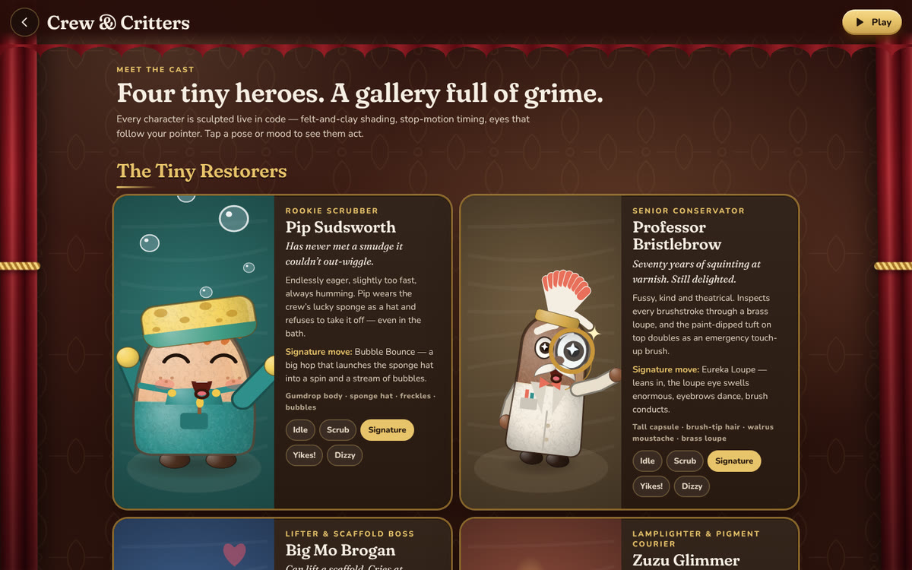
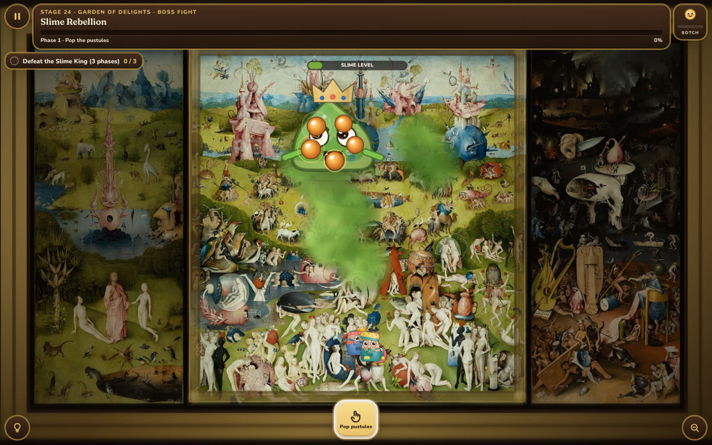
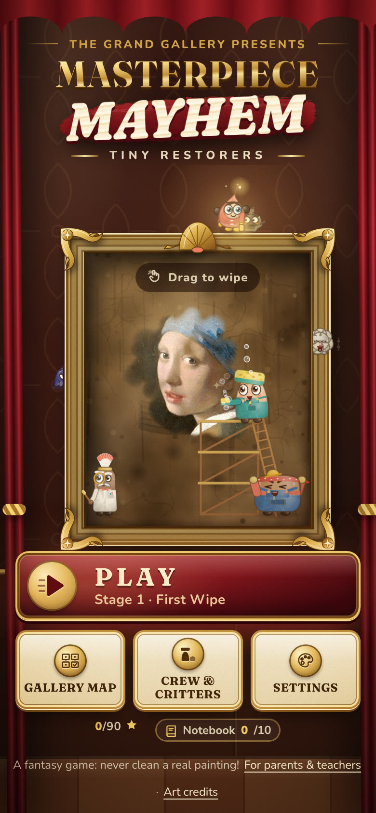
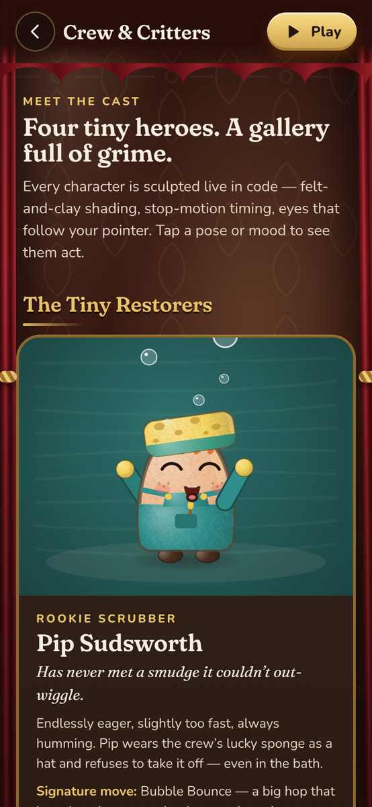
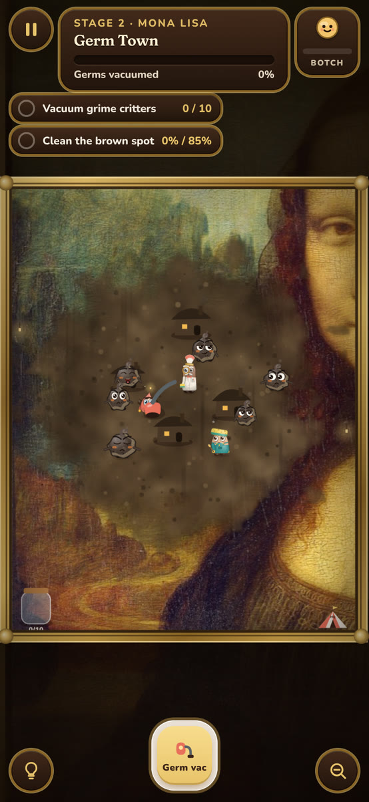

# Masterpiece Mayhem: Tiny Restorers

**Shrink down. Dive into the world's most famous paintings. Save them from a gallery full of grime.**

### ▶ [Play it free in your browser → masterpiece-mayhem.pages.dev](https://masterpiece-mayhem.pages.dev)

No download, no sign-up, no ads. Works with a mouse or a thumb, on desktop or phone.

**At a glance:** 10 public-domain masterpieces · 30 stages across 14 game mechanics · an original score arranged for every gallery · a fact notebook written at a 2nd-grade reading level · no accounts, ads or tracking · 131 KB of gzipped JavaScript, no game engine.


---

## What it is

You know the Mona Lisa. You've never seen her like this.

Masterpiece Mayhem drops you *into* ten famous paintings. Brushstrokes become hills, varnish becomes a peeling amber sky, and a crack in the paint becomes a road your crew drives pigment down. You scrub, peel, polish, route, lasso and build your way through **30 stages**, and each one ends the same way: you pull back and watch a masterpiece come back to life.

- **See it fast.** You recognise the painting within two seconds, and tiny characters are already up to something.
- **Play it right away.** Your first scrub happens in under ten seconds.
- **Stay for the variety.** Varnish peels, crack-road logistics, Seurat colour-mixing puzzles, a lasso roundup, a bridge-building physics puzzle and a three-phase slime-king boss fight.
- **Mistakes are fun, not fatal.** Over-scrub and the **Botch Meter** curses the painting with goofy, temporary distortions.

## For kids, parents and teachers

The learning lives inside the play, not in quizzes.

- **Conservator's Notebook.** Restoring any stage unlocks that painting's page: a fun opener, three short true facts, its size in kid terms ("taller than a basketball hoop") and where to see it in real life.
- **Look closer.** Numbered spots zoom into the real painting: the shadow of a hand on a coat, a missing eyebrow, Fuji hiding behind a wave.
- **Read to me.** Pages and captions can be read aloud with the device's built-in voice.
- **Real restorer tips.** Each results screen ends with one line about how real conservators work: test first, be gentle, keep repairs undo-able, write it down.
- **Written for early readers.** All kid-facing text averages 8.3 words per sentence (Flesch–Kincaid grade 2.5), and the test suite fails if anyone makes it harder.
- **Safe by design.** No ads, purchases, accounts, chat or analytics. Progress stays in the browser. Sharing a before/after clip only happens when the player taps Share, through the device's own share sheet.

A **Parents & teachers** page in Settings covers what players learn and how to use it in class.

## Meet the cast



**The Tiny Restorers**: four heroes, four silhouettes, four personalities.

| | |
|---|---|
| **Pip Sudsworth**, rookie scrubber | Gumdrop-shaped, freckled, wearing the crew's lucky sponge as a hat. |
| **Professor Bristlebrow**, senior conservator | Tall and theatrical, with brush-tip hair, a walrus moustache and a brass loupe. |
| **Big Mo Brogan**, lifter & scaffold boss | A gentle giant in a hard hat three sizes too small. |
| **Zuzu Glimmer**, lamplighter & pigment courier | The smallest and fastest, with an antenna lantern. |

**The Grimelings** are the troublemakers: **Smudge** the soot smudger, **Blotto** the wobbly ink stain, **Crackle** the craquelure critter, and their ruler **King Gloopus**, who swallowed a paintbrush, a button and a crown and kept the crown. They act: surprised, panicked, sneaky, and waving a tiny white flag when you win. Design rationale: [CHARACTER_BIBLE.md](CHARACTER_BIBLE.md).

## Ten masterpieces, five galleries, 30 stages

| Gallery | Paintings | You'll… |
|---|---|---|
| **I · Discovery** | *Mona Lisa*, *The Night Watch* | scrub soot, vacuum a germ village, mend cracks, peel golden varnish |
| **II · Restoration Workshop** | *Girl with a Pearl Earring*, *The Great Wave* | buff a pearl, route crack couriers, blast foam, steer rescue boats |
| **III · Living Canvas** | *Water Lilies*, *The Starry Night* | vacuum algae, command frog crews, surf brushstrokes, route pigment rivers |
| **IV · Color Kingdom** | *La Grande Jatte*, *Garden of Earthly Delights* | mix optical dots, lasso ink-imps, beat the Slime King |
| **V · Impossible Gallery** | *Arnolfini Portrait*, *Creation of Adam* | clean a convex mirror, dive into recursive reflections, build a bridge between fingertips |



<p>
  
  
  
</p>

## Music & sound

One original waltz theme, re-orchestrated for each room: a wind-up music box on the menu, pizzicato strings in Gallery I, marimba and flute in II, flute over harp in III, a cheeky bassoon in IV, clarinet and parlour piano in V, a minor-key march for King Gloopus and a slow hymn for the finale.

- **It grows as you restore.** Extra parts come in as the painting gets cleaner, and the win resolves the tune in key.
- **Sound that follows your hand.** Scrubbing, peeling and spraying get denser the harder you work; the vacuum motor spins up.
- **Recorded, not beeped.** 145 CC0 recordings (3.2 MB, loaded one gallery at a time), layered and varied so nothing repeats exactly.

## How it was built: the decisions that mattered

| Decision | Why | Trade-off accepted | How it was checked |
|---|---|---|---|
| No game engine or UI framework (Canvas 2D + plain DOM) | Fast first load on school Chromebooks and old phones; full control of the look | More code written by hand | 131 KB gzipped JS; two runtime dependencies, both fonts |
| Characters drawn in code, not sprite sheets | One felt-and-clay material for 4 heroes and 10 critters, at any size, in any mood | Art iteration happens in TypeScript | A Crew & Critters page and a 20px/48px readability check |
| Public-domain paintings with a fallback | Real masterpieces, never a broken image | Commercial release still needs a rights review (stated below) | Each file's status confirmed through the Wikimedia Commons API |
| Free CC0 recordings over a commissioned score | Real instruments now, at no cost; a composer can drop in later | A ceiling short of a bespoke score | Audio recorded from the engine: arrangements level-matched within about 1 LU, no clipping, pitch content matches each key |
| Learning inside play, not quizzes | Kids skip text that blocks them | Less content than a lesson plan | Reading is optional; the results card fits a small phone with Next always on screen |
| 2nd-grade reading level, enforced | Teachers and parents need it to be truly readable | Fewer, shorter facts | Unit tests cap sentence length and reading grade |
| Privacy by default | Children are the audience | No leaderboards or cloud saves | No network calls beyond the game's own assets |

## Built for everyone
- **Mobile and desktop:** portrait and landscape, touch and mouse, no accidental page scroll.
- **Accessible:** keyboard controls (Esc/P pause, Z zoom, H hint, 1–9 tools), focus rings, ARIA labels, live objective updates, reduced-motion mode, separate sound and music toggles, a six-step type scale with nothing below 12px.
- **Lightweight:** 131 KB of gzipped JavaScript and 15 KB of CSS, plus fonts, painting images and audio loaded per gallery.

## Run it locally

```bash
npm install
npm run dev          # http://localhost:5173 (or the port Vite prints)
npm run build        # typecheck + production build into dist/
npm run preview      # serve dist/ on http://localhost:4173
```

`?stage=12` jumps to an unlocked stage; `?qa` unlocks everything.

## Tests
- **Unit (Vitest):** `npm test` runs 65 tests: truss physics, courier routing, the character cast, the musical score (every note in key, no sample stretched past a fifth) and the notebook (sentence length, reading grade, hotspot placement).
- **Browser (Playwright):** `npm run test:e2e` builds the production bundle and runs 8 tests on desktop and phone viewports: the menu cast never covers a button, wiping removes real grime, routing, the Crew & Critters page, real scrub progress, an autoplayed stage-1 win, the notebook and look-closer flow, and the parents page.
- **Autoplay regression:** `node scripts/autoplay-all.mjs 1-30` runs the built-in solver on every stage against a running dev server.

## Status: the honest version
Playable today and live. What is verified and what isn't is in [DEVELOPMENT_STATUS.md](DEVELOPMENT_STATUS.md). In short:
- All 30 stages load and are interactive; the automated solver finishes 27. Stages 25, 29 and 30 haven't been confirmed winnable by the solver.
- No full human playtest on real phones yet, including the share clip and read-aloud, which depend on device features.
- The 30 notebook facts were written from well-documented sources and are pending review by a teacher.

## Credits & a friendly warning
The ten paintings are public-domain works; the bundled images are downscaled Wikimedia Commons files marked *Public domain* (sources and caveats in [ART_LICENSES.md](ART_LICENSES.md)). Some museums restrict commercial use of photos of their collections, so **a rights review is required before any commercial release.** Characters, grime, tools, UI, score and sound design are original. The recordings they use are CC0, from [Versilian Studios Chamber Orchestra 2 – Community Edition](https://github.com/sgossner/VSCO-2-CE) and [Kenney](https://kenney.nl).

> 🧽 **This is a fantasy.** Never scrub, peel, polish or spray a real painting. Leave that to trained conservators.

## License
Source code © 2026 manynames3, all rights reserved for now (no open-source licence chosen yet). Painting reproductions are public domain as described above. Audio recordings are CC0. Fonts: SIL Open Font License.
