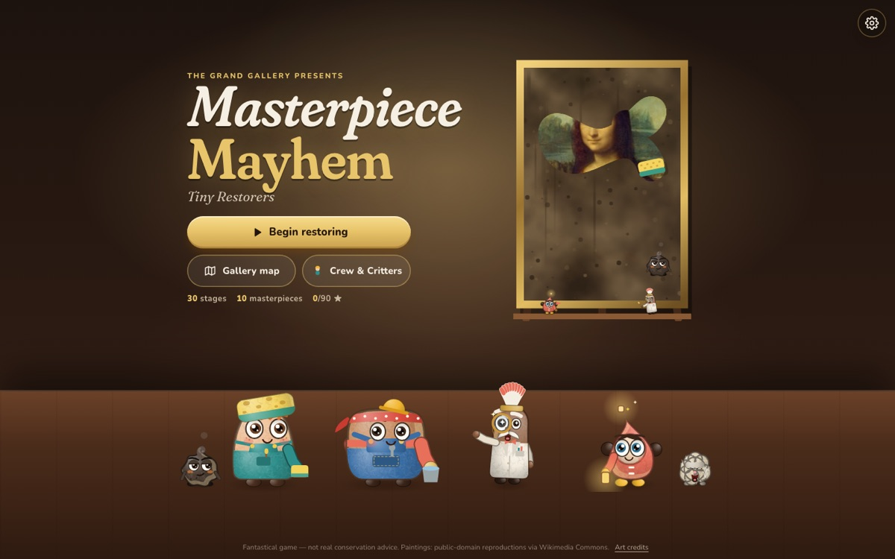
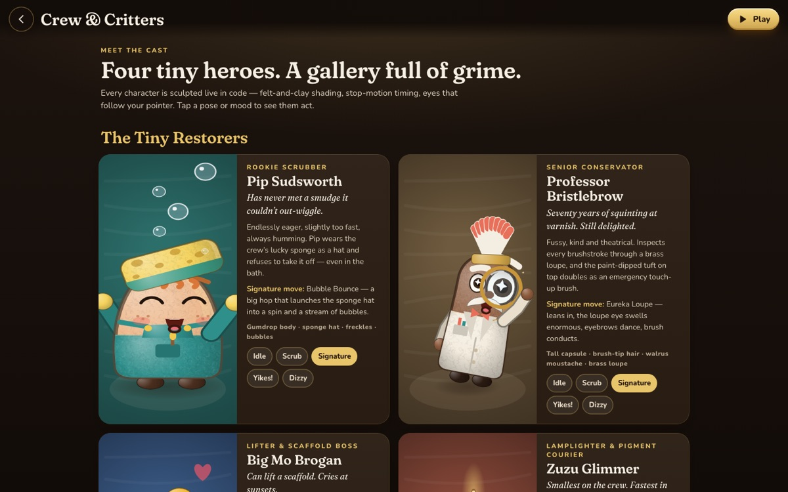
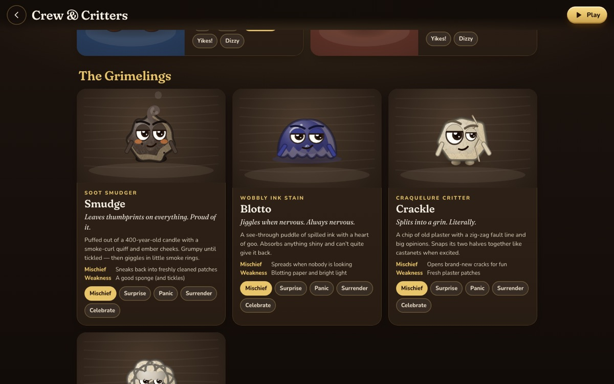
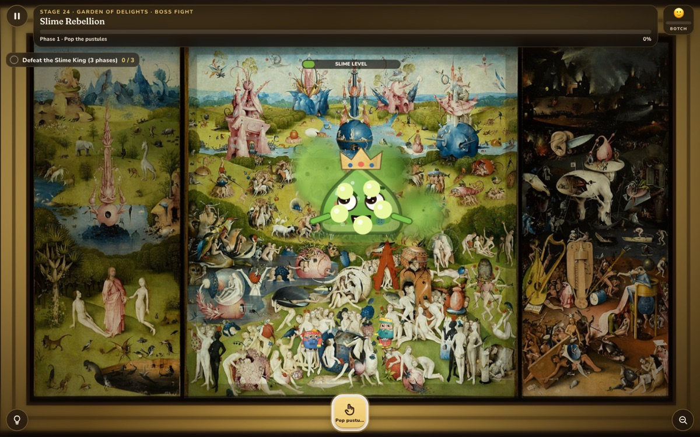
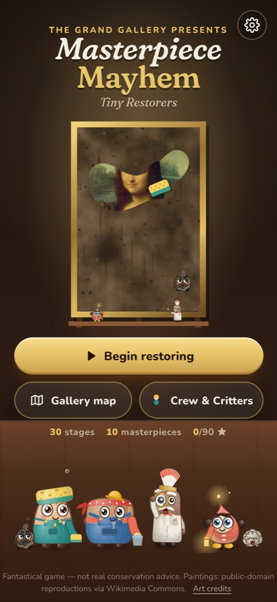
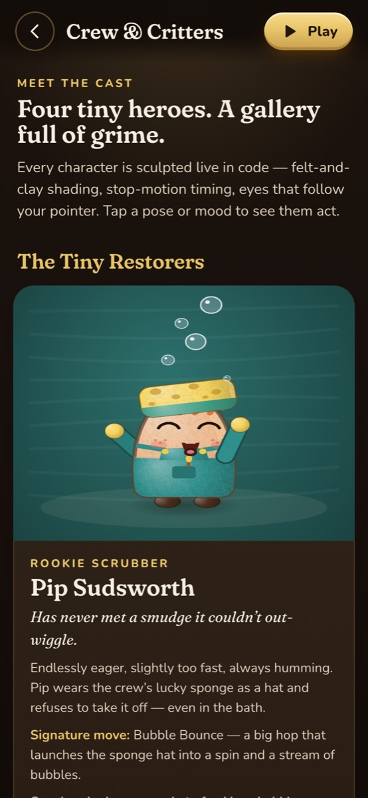
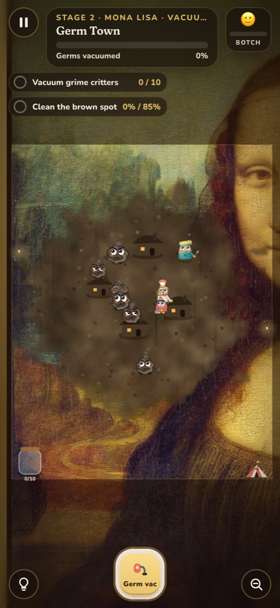

# Masterpiece Mayhem: Tiny Restorers

**Shrink down. Dive into the world's most famous paintings. Save them from a gallery full of grime.**

### ▶ [Play it free in your browser → masterpiece-mayhem.pages.dev](https://masterpiece-mayhem.pages.dev)

No download, no sign-up, no ads. Works with a mouse or a thumb, on desktop or phone.



---

## Why you'll love it

You know the Mona Lisa. You've never seen her like this.

Masterpiece Mayhem drops you *into* ten of the most famous paintings ever made. Brushstrokes become hills, varnish becomes a peeling amber sky, and a crack in the paint becomes a road your crew can drive pigment down. You scrub, peel, polish, route, lasso and build your way through **30 hand-designed stages**, and each one ends the same way: you pull back and watch a masterpiece come back to life.

- **See it fast.** You recognise the painting within two seconds, and tiny characters are already up to something.
- **Feel it right away.** Your first scrub happens in under ten seconds. Your first "whoa" reveal arrives in under a minute.
- **Stay for the variety.** This isn't 30 copies of "wipe the screen." You'll play varnish peels, crack-road logistics, Seurat colour-mixing puzzles, a lasso roundup, a bridge-building physics puzzle and a three-phase slime-king boss fight.
- **Mistakes are fun, not fatal.** Over-scrub and the **Botch Meter** curses the painting with goofy temporary distortions. Laugh, fix it, keep going.

## Meet the cast

The crew and the critters were built to be the reason you click.



**The Tiny Restorers**: four heroes, four silhouettes, four personalities.

| | |
|---|---|
| **Pip Sudsworth**, rookie scrubber | Gumdrop-shaped, freckled and wearing the crew's lucky sponge as a hat. Signature move: the *Bubble Bounce*. |
| **Professor Bristlebrow**, senior conservator | Tall and theatrical, with paint-dipped brush-tip hair, a walrus moustache and a brass loupe. Signature: the *Eureka Loupe*. |
| **Big Mo Brogan**, lifter & scaffold boss | Pillow-shaped gentle giant in a polka-dot bandana and a hard hat three sizes too small. Signature: the *Gentle Giant Flex*. |
| **Zuzu Glimmer**, lamplighter & pigment courier | The smallest and fastest. Paint-drop raincoat, antenna lantern, bouncing pigtails. Signature: the *Twinkle Twirl*. |

**The Grimelings**: the troublemakers you'll love to evict.



**Smudge** the soot smudger, **Blotto** the wobbly see-through ink stain, **Crackle** the craquelure critter, **Puffington** the sneezing dust puff, and their pompous ruler **King Gloopus**, who swallowed a paintbrush, a button and a crown and kept the crown. Plus Scorch, Nibs, Buzzby, Mossy and Glint, the one friendly sparkle you must *not* catch.

They don't just sit there. They act: surprised, panicked, sneaky, grumpy, celebrating, and waving a tiny white flag when you win. Every character is drawn live in code with a felt-and-clay look, stop-motion timing and eyes that follow your pointer. Open **Crew & Critters** from the title screen to meet them all. The full design rationale is in [CHARACTER_BIBLE.md](CHARACTER_BIBLE.md).

## Ten masterpieces, five galleries, 30 stages

| Gallery | Paintings | You'll… |
|---|---|---|
| **I · Discovery** | *Mona Lisa*, *The Night Watch* | scrub soot, vacuum a germ village, mend cracks, peel golden varnish |
| **II · Restoration Workshop** | *Girl with a Pearl Earring*, *The Great Wave* | buff a pearl, route crack couriers, blast foam, steer rescue boats |
| **III · Living Canvas** | *Water Lilies*, *The Starry Night* | vacuum algae, command frog crews, surf brushstrokes, route pigment rivers |
| **IV · Color Kingdom** | *La Grande Jatte*, *Garden of Earthly Delights* | mix optical dots, lasso ink-imps, beat the Slime King |
| **V · Impossible Gallery** | *Arnolfini Portrait*, *Creation of Adam* | clean a convex mirror, dive into recursive reflections, build a bridge between fingertips |

Every painting has three beats: the grimy overview, the hidden micro-world, and the big restored reveal. Stars reward skill, not just speed. Progress saves on your device.



<p>
  
  
  
</p>

## Built for everyone
- **Mobile and desktop:** responsive portrait and landscape layouts, touch and mouse, with no accidental page scroll while you play.
- **Accessible:** keyboard shortcuts (Esc/P pause, Z zoom, H hint, 1–9 tools), visible focus rings, ARIA labels, live objective updates, a reduced-motion mode and separate sound and music toggles.
- **Lightweight:** Canvas 2D and plain DOM, with no game engine or framework runtime. About 105 KB of gzipped JS plus fonts and painting images.

## Run it locally

```bash
npm install
npm run dev          # http://localhost:5173 (or the port Vite prints)
npm run build        # typecheck + production build into dist/
npm run preview      # serve dist/ on http://localhost:4173
```

Handy URL flags while developing: `?stage=12` jumps to an unlocked stage, and `?qa` unlocks everything.

## Tech & tests
- **Stack:** TypeScript, Vite, Canvas 2D, Web Audio. Fonts: Fraunces and Nunito (OFL).
- **Unit tests (Vitest):** `npm test` covers truss physics, courier routing and the character cast registry.
- **Browser smoke tests (Playwright):** `npx playwright install chromium` once, then `npm run test:e2e`. It builds the production bundle and checks the title ensemble, the Crew & Critters showcase, real scrub progress, and a full autoplayed stage-1 win, on both desktop and mobile viewports.
- **Autoplay regression:** `node scripts/autoplay-all.mjs 1-30` runs the built-in QA solver on every stage against a running dev server (edit the base URL argument if your port differs).

## Status: honest version
Playable today, still being polished. See [DEVELOPMENT_STATUS.md](DEVELOPMENT_STATUS.md) for exactly what's verified and what isn't. In short: all 30 stages load and are interactive. The automated solver finishes 27 of them. Stages 25, 29 and 30 haven't been confirmed winnable by the solver, and no stage has had a full human playtest pass on real phones yet.

## Art, credits & a friendly warning
The ten paintings are public-domain works. The bundled images are downscaled copies of files marked *Public domain* on Wikimedia Commons; sources and caveats are in [ART_LICENSES.md](ART_LICENSES.md). Some museums restrict commercial use of photographs of their collections, so **a rights review is required before any commercial release.** The characters, grime, tools and UI are original art made for this project.

> 🧽 **This is a fantasy.** Nothing here is real conservation advice. Never scrub, peel, polish or spray a real painting. Leave that to trained conservators.

## License
The source code is © 2026 manynames3, all rights reserved for now (no open-source licence has been chosen yet). Painting reproductions are public domain as described above. Fonts are under the SIL Open Font License.
